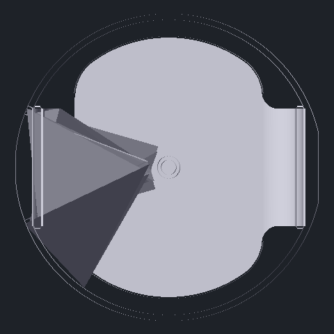
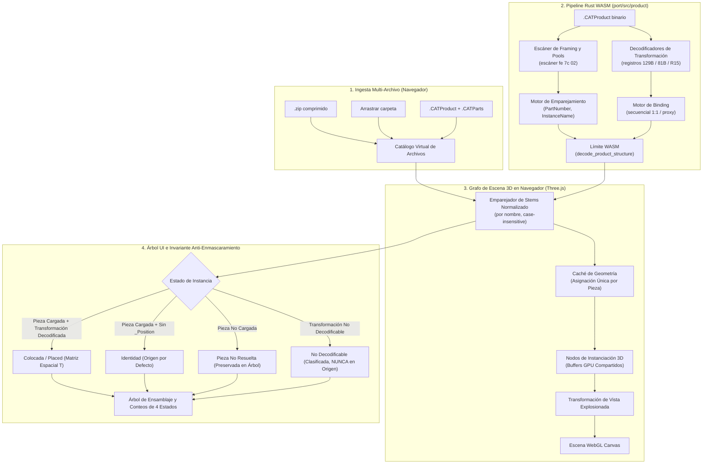

# catpart-parser

Un parser open source para archivos de pieza y producto de **CATIA V5** de
Dassault Systèmes (`.CATPart`, `.CATProduct`) — leyendo el formato binario
directamente, **sin necesidad de una instalación de CATIA**.

[](https://github.com/MadManJohnSmith/catpart-parser/actions/workflows/ci.yml)
[](https://github.com/MadManJohnSmith/catpart-parser/blob/main/fitness/history.jsonl)

**Pruébalo en vivo** — corre entero en tu navegador (WebAssembly; los archivos
nunca salen de la máquina): arrastra un `.CATPart` — o un `.CATProduct` con su
carpeta de piezas / `.zip` — sobre el
[visor](https://madmanjohnsmith.github.io/catpart-parser/viewer/viewer.html).
Más ejemplos de salida decodificada en la
[galería de exportaciones](https://madmanjohnsmith.github.io/catpart-parser/gallery.html).


El badge L1 es el titular de fitness (un titular por nivel, ADR-0001), leído
del endpoint de `gh-pages` y refrescado localmente por
`scripts/publish_fitness.py` — nunca en CI (ADR-0003). La serie de
corridas aceptadas de L1 y L2 vive en `fitness/history.jsonl` (append-only) y
`fitness-history.json`.

## Por qué

CATIA V5 guarda los modelos en un formato binario propietario y sin
documentar. Hoy las únicas formas de leer estos archivos son:

- Convertidores comerciales (de pago, código cerrado).
- Automatización COM de una instancia de CATIA en ejecución (requiere
  licencia de pago).

No existe ningún parser binario libre y open source. Este proyecto pretende
ser el primero completo, habilitando interoperabilidad, acceso de archivo y
tooling para quien recibe archivos CATIA sin tener un puesto de CATIA.

## Qué funciona hoy

| Capacidad | Resultado | Evidencia |
|---|---|---|
| **L1 — metadatos y contenedores** (`catpart-inspect`) | 99.66% Dev (1,745/1,751), 100% held-out (73/73) — Fase 3 cerrada 2026-11-08 | [ROADMAP](docs/ROADMAP.md), [docs de formato](docs/format/README.md) |
| **L2 — exportación de mallas** (`catpart-export` → PLY binario) | 78.64% Dev (1,086/1,381), 57/61 held-out; Fase 4 cerrada 2026-11-13 al 74.80%, elevada por los fixes post-v1.0 | [cierre](docs/evidence/2026-11-13-phase4-close.md) |
| **Visor de piezas** (WASM, en el navegador) | Fidelidad Rust/Python 3,266/3,266 (0 mismatches, corrida completa de ambos slices del corpus); reproducción del escalar en el navegador WITHIN exact con el margen declarado 0 — Fase 5 cerrada 2026-11-14 | [corrida de fidelidad](docs/evidence/2026-11-14-v6-fidelity-full-corpus.md), [aceptación](docs/evidence/2026-11-14-v6-phase5-close.md) |
| **Visor de ensamblajes** (`.CATProduct`, multi-archivo) | Ingesta por arrastre de carpeta/`.zip`, transformaciones decodificadas `[tx, ty, tz, qw, qx, qy, qz]` (f64le, cuaternión w-first), render instanciado en GPU, vista explosionada, árbol de clasificación de 4 estados; Barra de Ensamblaje P4 cumplida dígito por dígito, aceptación headless 8/8 — Fase 6 cerrada 2026-11-16 | [spec](docs/specs/phase6-assembly-viewer-spec.md), [barra](docs/evidence/2026-11-14-p4-assembly-bar.md), [revisión](docs/evidence/2026-11-16-p3-v6-acceptance-review.md) |
| **L3 — constructos B-rep** | 23/23 constructos congelados resueltos (14 decodificados, 9 cerrados con techos publicados), L3 23/23 aceptado — Fase 7 cerrada 2026-11-18 | [cierre](docs/evidence/2026-11-18-phase7-close.md) |

Una malla L2 decodificada — una entrada de la
[galería de exportaciones](https://madmanjohnsmith.github.io/catpart-parser/gallery.html)
(render del PLY exportado para una pieza del corpus, del conjunto de
render-sanity de la Fase 4):



Notas:

- La población L2 es solo de piezas: los products muestreados no llevan
  stores de geometría (0/37 — negativo documentado,
  [docs/evidence/2026-11-08-geometry-payloads.md](docs/evidence/2026-11-08-geometry-payloads.md)).
- Cada clase de fallo residual de L2 está cerrada por bytes contra evidencia
  commiteada; la tabla por clase vive en el documento de cierre de la Fase 4.
- Las transformaciones no decodificables se clasifican como tales — nunca se
  enmascaran al origen de identidad; las piezas no resueltas se preservan en
  el árbol de instancias — nunca se ocultan.

## Inicio rápido

Requiere Python ≥ 3.11. Sin instalación de CATIA, sin licencia.

```console
$ pip install .

$ catpart-inspect model.CATPart      # JSON schema-v1: cabecera, inventario
                                     # de contenedores, document_name, trailer
$ catpart-export model.CATPart -o mesh.ply
                                     # exportación de geometría (PLY binario);
                                     # los fallos clasificados salen con código 1
                                     # y un JSON error_class en stderr
$ catpart-fitness                    # protocolo de fitness del corpus
                                     # (ADR-0001); ejecutar desde la raíz
```

Opción en el navegador (sin instalar nada): el
[visor](https://madmanjohnsmith.github.io/catpart-parser/viewer/viewer.html)
de arriba — órbita/zoom, wireframe/sólido, panel de metadatos, overlay de
curvas, compuerta de sanidad en el navegador, vista de ensamblaje
explosionada.

## Documentación

| Documento | Contenido |
|---|---|
| [docs/format/README.md](docs/format/README.md) | La documentación del formato `.CATPart`/`.CATProduct` obtenida por ingeniería inversa |
| [docs/ROADMAP.md](docs/ROADMAP.md) | Plan fase por fase y bloques de estado |
| [docs/adr/](docs/adr/) | ADRs: 0001 protocolo de fitness · 0002 parser Python-first · 0003 corridas locales de fitness + publicación en gh-pages · 0004 visor web en estado terminal |
| [docs/specs/](docs/specs/) | Autoridades de diseño por fase (visor, visor de ensamblajes) |
| [docs/evidence/](docs/evidence/) | Notas de evidencia fechadas + CSVs de claims detrás de cada cifra titular |
| [docs/corpus-report.md](docs/corpus-report.md) | El corpus público: composición y resumen de triage |
| [docs/research/format-landscape.md](docs/research/format-landscape.md) | Estudio de los lectores de CATIA existentes (el contexto de *Por qué*, en detalle) |

## Hoja de ruta

| Nivel / Fase | Entregable | Estado |
|---|---|---|
| L0 | Corpus público + triage a nivel de bytes con evidencia reproducible | hecho (Fases 0/1) |
| L1 | Mapa de contenedores/secciones, metadatos, inventario de contenedores, nombres | hecho (Fase 3) |
| L2 | Geometría básica: mallas y curvas exportables a STEP o renderizables | cerrada al 74.80% (barra re-ajustada); ahora 78.64% tras los fixes post-v1.0 |
| Fase 5 (Visor: Piezas) | Parseo de .CATPart en WebAssembly en cliente, render 3D WebGL | hecho (Fase 5) |
| Fase 6 (Ensamblajes) | Parseo de .CATProduct en cliente, instanciación multi-pieza, colocación 3D | hecho (Fase 6) |
| L3 | B-rep paramétrico completo (sólidos CAD precisos) | cerrada el 2026-11-18 — 23/23 constructos resueltos (14 decodificados, 9 cerrados con techos publicados); L3 23/23 aceptado |

## Progreso

Resumen spec por spec — el estado autoritativo por ticket vive en el
[issue tracker](https://github.com/MadManJohnSmith/catpart-parser/issues).

| Spec | Alcance | Estado |
|---|---|---|
| A — tooling y CI ([#8](https://github.com/MadManJohnSmith/catpart-parser/issues/8)) | esqueleto del paquete, CLI, generador de fixtures, runner de fitness, GitHub Actions, gh-pages | 6/6 hecho (2026-11-09) |
| B — inferencia de formato ([#9](https://github.com/MadManJohnSmith/catpart-parser/issues/9)) | tabla de contenedores y trailer, semántica de cabecera/cola, payload blocks, CGMGeom/CATCGRCont, R19 vs R21, doc de formato v1 | 6/6 hecho (2026-11-09) |
| C — parser L1 ([#10](https://github.com/MadManJohnSmith/catpart-parser/issues/10)) | schema v1 + baseline, árbol de features, nombres/unidades, aceptación, publicación | 5/5 hecho (Fase 3, 2026-11-08) |
| D — geometría L2 ([#28](https://github.com/MadManJohnSmith/catpart-parser/issues/28)) | navegación de stores, vertex pool, semántica de primitivas, CLI de exportación, fitness L2, grind hasta la barra | 6/6 hecho (Fase 4, 2026-11-13; ahora 78.64% tras los fixes post-v1.0) |
| E — visor WASM ([#39](https://github.com/MadManJohnSmith/catpart-parser/issues/39)) | toolchain Rust, port L1/L2 + arnés de fidelidad, decode composite, límite WASM + shell del visor, reproducción en el navegador, publicación | 7/7 hecho (Fase 5, 2026-11-14) |
| F — ensamblajes ([#45](https://github.com/MadManJohnSmith/catpart-parser/issues/45)) | censo de products, ley de emparejamiento, transformaciones y binding de instancias, núcleo de producto en WASM, ingesta multi-archivo, colocación 3D, UI + árbol de clasificación, aceptación headless con Playwright | 12/12 hecho (Fase 6, 2026-11-16) |
| G — B-rep ([#47](https://github.com/MadManJohnSmith/catpart-parser/issues/47)) | B-rep paramétrico completo (Fase 7) | 6/6 hecho (Fase 7, 2026-11-18) |

## Arquitectura

Dos implementaciones mantenidas en sincronía por el arnés de fidelidad: la
referencia en Python (`src/catpart/`) y el port Rust→WASM (`port/`) que
alimenta al visor del navegador. El pipeline de ensamblajes:



## Desarrollo

Layout del repositorio:

| Ruta | Contenido |
|---|---|
| `src/catpart/` | Implementación de referencia en Python (`catpart-inspect` / `-export` / `-fitness`) |
| `port/` | Port Rust → WASM que alimenta al visor del navegador (toolchain fijado en `port/rust-toolchain.toml`) |
| `docs/` | docs de formato, ROADMAP, ADRs, specs, evidencia |
| `fitness/` | `history.jsonl` + reportes por corrida (append-only) |
| `manifests/` | CSV del manifest del corpus |
| `scripts/` | scripts de triage, publicación de fitness, runners de aceptación |
| `viewer/` | fuentes del visor del navegador — publicadas desde la rama `gh-pages` |

Setup local y merge gate (espejo de CI):

```console
$ python -m venv .venv && .venv/bin/pip install -e '.[test,lint]'
$ scripts/check.sh    # ruff fijado + pytest + la suite cargo de port/
```

El corpus nunca se commitea, descarga ni cachea — CI corre sin fixtures
(ADR-0003); las corridas reales de fitness suceden localmente en la máquina
que tiene `corpus/` y publican a `gh-pages`.

## Método

- **Dirigido por corpus.** El fitness es la proporción del corpus que parsea
  limpiamente (L1), más la proporción de sanidad geométrica L2 de las piezas
  cuya exportación es sana (malla manifold no vacía, bounding box finito;
  el volumen cerrado donde se espera se reporta como componente, no como
  compuerta).
- **Dirigido por evidencia.** Cada afirmación estructural está atada a rangos
  de bytes concretos y digests de archivo; los hallazgos negativos también se
  registran.
- **Ingeniería inversa solo para interoperabilidad.** Documentamos estructuras
  observadas; no se redistribuye código propietario. Ver *Legal* abajo.

## Legal

Ingeniería inversa de un formato de archivo para interoperabilidad. Este
proyecto no redistribuye código de Dassault ni usa especificaciones filtradas.
La documentación del formato producida aquí se deriva de observar archivos
reales y el comportamiento documentado de herramientas.

## Licencia

[Apache-2.0](LICENSE) — elegida por su concesión explícita de patentes.
