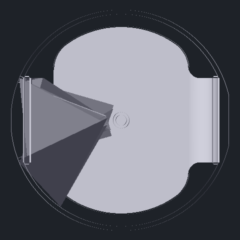
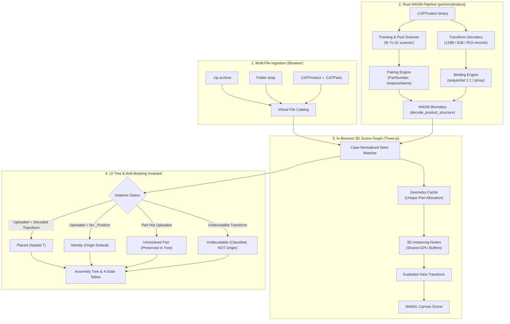

# catpart-parser

An open-source parser for Dassault Systèmes **CATIA V5** part and product
files (`.CATPart`, `.CATProduct`) — reading the binary format directly,
**without a CATIA installation**.

[](https://github.com/MadManJohnSmith/catpart-parser/actions/workflows/ci.yml)
[](https://github.com/MadManJohnSmith/catpart-parser/blob/main/fitness/history.jsonl)

**Try it live** — runs entirely in your browser (WebAssembly; files never
leave the machine): drag a `.CATPart` — or a `.CATProduct` with its parts
folder / `.zip` — onto the
[viewer](https://madmanjohnsmith.github.io/catpart-parser/viewer/viewer.html).
More decoded-output examples in the
[export gallery](https://madmanjohnsmith.github.io/catpart-parser/gallery.html).


The L1 badge is the fitness headline (one headline per level, ADR-0001),
read from the `gh-pages` endpoint and refreshed locally by
`scripts/publish_fitness.py` — never in CI. The accepted-run series for L1
and L2 lives in `fitness/history.jsonl` (append-only) and
`fitness-history.json`.

## Why

CATIA V5 stores models in a proprietary, undocumented binary format. Today the
only ways to read these files are:

- Commercial converters (paid, closed source).
- COM automation of a running CATIA instance (requires a paid license).

There is no free, open-source binary parser. This project aims to be the
first complete one, enabling interoperability, archival access, and tooling
for everyone who receives CATIA files without owning a CATIA seat.

## What works today

| Capability | Result | Evidence |
|---|---|---|
| **L1 — metadata & containers** (`catpart-inspect`) | 99.66% Dev (1,745/1,751), 100% held-out (73/73) — Phase 3 closed 2026-11-08 | [ROADMAP](docs/ROADMAP.md), [format docs](docs/format/README.md) |
| **L2 — mesh export** (`catpart-export` → binary PLY) | 74.80% Dev (1,033/1,381), 56/61 held-out; closed at the measured ceiling with documented negatives, bar re-adjusted under the pre-authorized rule — Phase 4 closed 2026-11-13 | [close-out](docs/evidence/2026-11-13-phase4-close.md) |
| **Part viewer** (WASM, in the browser) | Rust/Python fidelity 3,266/3,266 (0 mismatches, full dual-slice corpus run); in-browser scalar reproduction WITHIN exact at the declared margin 0 — Phase 5 closed 2026-11-14 | [fidelity run](docs/evidence/2026-11-14-v6-fidelity-full-corpus.md), [acceptance](docs/evidence/2026-11-14-v6-phase5-close.md) |
| **Assembly viewer** (`.CATProduct`, multi-file) | Folder/`.zip` drag-drop ingestion, decoded `[tx, ty, tz, qw, qx, qy, qz]` transforms (f64le, w-first quaternion), GPU-instanced rendering, exploded view, 4-state classification tree; P4 Assembly Bar met digit-for-digit, headless acceptance 8/8 — Phase 6 closed 2026-11-16 | [spec](docs/specs/phase6-assembly-viewer-spec.md), [bar](docs/evidence/2026-11-14-p4-assembly-bar.md), [review](docs/evidence/2026-11-16-p3-v6-acceptance-review.md) |
| **L3 — full parametric B-rep** | in progress (Phase 7, [Spec G #47](https://github.com/MadManJohnSmith/catpart-parser/issues/47)) | — |

A decoded L2 mesh — one entry of the
[export gallery](https://madmanjohnsmith.github.io/catpart-parser/gallery.html)
(render of the exported PLY for a corpus part, from the Phase 4
render-sanity set):



Notes:

- The L2 population is parts-only: sampled products carry no geometry
  stores (0/37 — documented negative,
  [docs/evidence/2026-11-08-geometry-payloads.md](docs/evidence/2026-11-08-geometry-payloads.md)).
- Every residual L2 failure class is byte-closed against committed
  evidence; the per-class table lives in the Phase 4 close-out doc.
- Undecodable transforms are classified as such — never masked to identity
  origin; unresolved parts are preserved in the instance tree — never
  hidden.

## Quick start

Requires Python ≥ 3.11. No CATIA installation, no license needed.

```console
$ pip install .

$ catpart-inspect model.CATPart      # schema-v1 JSON: header, container
                                     # inventory, document_name, trailer
$ catpart-export model.CATPart -o mesh.ply
                                     # geometry export (binary PLY); classified
                                     # failures exit 1 with an error_class JSON
                                     # on stderr
$ catpart-fitness                    # corpus fitness protocol (ADR-0001);
                                     # run from the repository root
```

Browser option (no install): the
[viewer](https://madmanjohnsmith.github.io/catpart-parser/viewer/viewer.html)
at the top of this page — orbit/zoom, wireframe/solid, metadata panel,
curve overlay, in-browser sanity gate, exploded assembly view.

## Documentation

| Doc | Contents |
|---|---|
| [docs/format/README.md](docs/format/README.md) | The reverse-engineered `.CATPart`/`.CATProduct` format documentation |
| [docs/ROADMAP.md](docs/ROADMAP.md) | Phase-by-phase plan and status blocks |
| [docs/adr/](docs/adr/) | ADRs: 0001 fitness protocol · 0002 Python-first parser · 0003 local fitness runs + gh-pages publication · 0004 terminal-state web viewer |
| [docs/specs/](docs/specs/) | Design authorities per phase (viewer, assembly viewer) |
| [docs/evidence/](docs/evidence/) | Dated evidence notes + claims CSVs behind every headline number |
| [docs/corpus-report.md](docs/corpus-report.md) | The public corpus: composition and triage summary |
| [docs/research/format-landscape.md](docs/research/format-landscape.md) | Survey of existing CATIA readers (the "Why" context, in depth) |

## Roadmap

| Level / Phase | Deliverable | Status |
|---|---|---|
| L0 | Public corpus + byte-level triage with reproducible evidence | done (Phase 0/1) |
| L1 | Container/section map, metadata, container inventory, names | done (Phase 3) |
| L2 | Geometry basics: meshes and curves exportable to STEP or renderable | closed at 74.80% (bar re-adjusted per the pre-authorized rule) |
| Phase 5 (Viewer: Parts) | Client-side .CATPart parsing in WebAssembly, 3D WebGL render | done (Phase 5) |
| Phase 6 (Assemblies) | Client-side .CATProduct parsing, multi-part instancing, 3D placement | done (Phase 6) |
| L3 | Full parametric B-rep (precise CAD solids) | planned, hardest (Phase 7) |

## Progress

Spec-by-spec summary — authoritative per-ticket state lives in the
[issue tracker](https://github.com/MadManJohnSmith/catpart-parser/issues).

| Spec | Scope | State |
|---|---|---|
| A — tooling & CI ([#8](https://github.com/MadManJohnSmith/catpart-parser/issues/8)) | package skeleton, CLI, fixture generator, fitness runner, GitHub Actions, gh-pages | 6/6 done (2026-11-09) |
| B — format inference ([#9](https://github.com/MadManJohnSmith/catpart-parser/issues/9)) | container table & trailer, header/tail semantics, payload blocks, CGMGeom/CATCGRCont, R19 vs R21, format doc v1 | 6/6 done (2026-11-09) |
| C — L1 parser ([#10](https://github.com/MadManJohnSmith/catpart-parser/issues/10)) | schema v1 + baseline, feature tree, names/units, acceptance, publication | 5/5 done (Phase 3, 2026-11-08) |
| D — L2 geometry ([#28](https://github.com/MadManJohnSmith/catpart-parser/issues/28)) | store navigation, vertex pool, primitive semantics, export CLI, L2 fitness, grind to bar | 6/6 done (Phase 4, 2026-11-13, closed at 74.80%) |
| E — WASM viewer ([#39](https://github.com/MadManJohnSmith/catpart-parser/issues/39)) | Rust toolchain, L1/L2 port + fidelity harness, composite decode, WASM boundary + viewer shell, in-browser reproduction, publication | 7/7 done (Phase 5, 2026-11-14) |
| F — assemblies ([#45](https://github.com/MadManJohnSmith/catpart-parser/issues/45)) | product census, pairing law, transforms & instance binding, WASM product core, multi-file ingestion, 3D placement, UI + classification tree, headless Playwright acceptance | 12/12 done (Phase 6, 2026-11-16) |
| G — B-rep ([#47](https://github.com/MadManJohnSmith/catpart-parser/issues/47)) | full parametric B-rep (Phase 7) | in progress |

## Architecture

Two implementations kept in lockstep by the fidelity harness: the Python
reference (`src/catpart/`) and the Rust→WASM port (`port/`) that powers the
browser viewer. The assembly pipeline:



## Development

Repository layout:

| Path | Contents |
|---|---|
| `src/catpart/` | Python reference implementation (`catpart-inspect` / `-export` / `-fitness`) |
| `port/` | Rust → WASM port powering the browser viewer (toolchain pinned in `port/rust-toolchain.toml`) |
| `docs/` | format docs, ROADMAP, ADRs, specs, evidence |
| `fitness/` | `history.jsonl` + per-run reports (append-only) |
| `manifests/` | corpus manifest CSV |
| `scripts/` | triage scripts, fitness publication, acceptance runners |
| `viewer/` | browser viewer sources — published from the `gh-pages` branch |

Local setup and merge gate (mirrors CI):

```console
$ python -m venv .venv && .venv/bin/pip install -e '.[test,lint]'
$ scripts/check.sh    # pinned ruff + pytest + the port/ cargo suite
```

The corpus is never committed, downloaded or cached — CI runs fixture-free
(ADR-0003); real fitness runs happen locally on the machine holding
`corpus/` and publish to `gh-pages`.

## Method

- **Corpus-driven.** Fitness is the share of the corpus that parses
  cleanly (L1), plus the L2 geometry-sanity share of parts whose export
  is sane (non-empty manifold mesh, finite bounding box;
  closed-volume-where-expected is reported as a component, not gated).
- **Evidence-driven.** Every structural claim is tied to concrete byte ranges
  and file digests; negative findings are recorded too.
- **Interop-only reverse engineering.** We document observed structures; no
  proprietary code is redistributed. See *Legal* below.

## Legal

Reverse engineering a file format for interoperability. This project
redistributes no Dassault code and does not use leaked specifications. The
format documentation produced here is derived from observing real files and
documented tool behavior.

## License

[Apache-2.0](LICENSE) — chosen for its explicit patent grant.
