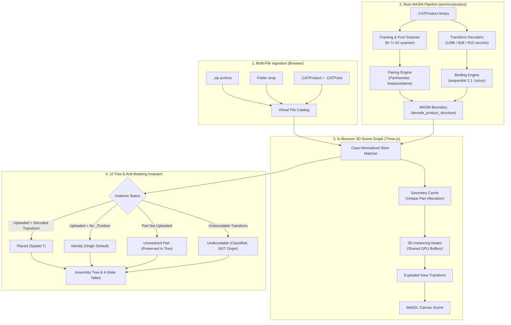

# catpart-parser

An open-source parser for Dassault Systèmes **CATIA V5** part and product
files (`.CATPart`, `.CATProduct`) — reading the binary format directly,
**without a CATIA installation**.

## Why

CATIA V5 stores models in a proprietary, undocumented binary format. Today the
only ways to read these files are:

- Commercial converters (paid, closed source).
- COM automation of a running CATIA instance (requires a paid license).

There is no free, open-source binary parser. This project aims to be the
first complete one, enabling interoperability, archival access, and tooling
for everyone who receives CATIA files without owning a CATIA seat.

## Status

**L1 parser shipped — Phase 3 closed (2026-11-08).** `catpart-inspect`
emits schema-v1 JSON (header, container inventory with base-class
annotation, `document_name`, trailer, detected version) and
`catpart-fitness` measures clean-parse over the corpus: **Dev 99.66%
(1745/1751), held-out 100% (73/73)**, no-regret per ADR-0001. See
[docs/ROADMAP.md](docs/ROADMAP.md) (Phase 3 status block),
[docs/format/README.md](docs/format/README.md) (documented structures)
and `fitness/history.jsonl`. Published live: the badge above reads the
`gh-pages` endpoint, refreshed locally by `scripts/publish_fitness.py`
(ADR-0003, never in CI) — rebuilds and force-pushes the `gh-pages` JSON.

**L2 geometry-sanity (spec D, [#33](https://github.com/MadManJohnSmith/catpart-parser/issues/33)) —
shipped, baseline published.** `catpart-fitness` also measures
the L2 scalar per ADR-0001: the share of `kind=part` manifest rows whose
`catpart-export` output passes sanity — export success, non-empty mesh,
manifold, finite plausible bounding box, no degenerate triangles above
the G3 F7 threshold (0 on every clean-store soup). The L2 population is
parts-only: products are excluded (the documented negative — 0/37
sampled products carry any geometry store,
[docs/evidence/2026-11-08-geometry-payloads.md](docs/evidence/2026-11-08-geometry-payloads.md)).
Component signals (closed-volume-where-expected, open shells, degenerate
counts) are reported per run and never collapse into the headline; the
badge above stays L1 (one headline per level, ADR-0001), and
`fitness-history.json` carries the L2 accepted-run series next to L1.
The accepted L2 baseline (run `20261110T172440Z-3ea53d`, 2026-11-10):
**Dev 76/1,381 = 5.50%, held-out 0/61**. The gap is classified, not
anecdotal: 1,024 `undecoded-variant` (composite index space, unpinned
0x4b/0x4e and 0x41/0x44 primitive readings — the open items that gate
the bar), 313 `missing-geometry-store` (consistent with the documented
0.82–0.93 store-presence range), 29 `malformed-store-header`; of the 76
passes, 66 closed volumes + 10 open shells (component signals).
[#34](https://github.com/MadManJohnSmith/catpart-parser/issues/34) (G6)
grinds the undecoded variants toward the ≥ 80% bar under no-regret.

**Grind status (2026-11-13, CLOSE):** the final accepted row (run
`20261113T231506Z-c2ab64`) puts L2 at **Dev 1,033/1,381 = 74.80%,
held-out 56/61**, L1 flat, exports 1,173 — up from the 76-pass
baseline through 15 landed #34 stages (per-rep pool absorption +
width laws, locator recovery incl. the other-container extension,
composite table-walk / per-rep / raw-array decode, the E0
curve-entry law, the stage-13 element-space law, and the
stage-15 dup-pin-ALL + unordered-dedup levers, owner-authorized).
The 80% bar is unreachable: the measured ceiling of the residual
is exactly what landed (+32), and every remaining failure class is
byte-closed against any committed-evidence law (128 no-pool stores
carry ZERO facet records; 125 missing-locator headers are
unreachable; the UV family's element coordinates are not in the
payload; the not-manifold failures are content-fins/coplanar books
in the bytes). Under the ROADMAP's pre-authorized bar-revision rule
the L2 bar re-adjusts to the measured ceiling **74.80% (margin 0)**
with documented negatives — the full per-class table and the
render-sanity gate (PASS, 6-store Dev subset) live in
[docs/evidence/2026-11-13-phase4-close.md](docs/evidence/2026-11-13-phase4-close.md).
History: `fitness/history.jsonl` (append-only).

**Viewer status (2026-11-14, Phase 5 CLOSED):** the decode pipeline is
ported to Rust compiled to WASM (ADR-0004) with Fidelity proven over
the corpus — the full dual-slice run (one CSV, both slices, no
sampling): **3,266/3,266 match, 0 mismatches, 0 harness-errors**
(L1-JSON all 1,824 manifest rows; L2-export all 1,442 parts: 1,173
byte-identical PLYs + 269 classified refusals reproduced exactly,
pairwise — `undecoded-variant` 144, `missing-geometry-store` 125),
wall-clock 255.9 s
([docs/evidence/2026-11-14-v6-fidelity-full-corpus.md](docs/evidence/2026-11-14-v6-fidelity-full-corpus.md),
`docs/evidence/data/v6-fidelity-full-corpus-claims.csv`). The
in-browser reproduction run matched the published L2 scalar
digit-for-digit under the owner-declared margin 0 (V5, #52: dev
1,033/1,381, held-out 56/61 — WITHIN exact). The viewer is live on
gh-pages: drag-drop a `.CATPart` at
[viewer/viewer.html](https://madmanjohnsmith.github.io/catpart-parser/viewer/viewer.html)
— orbit/zoom, wireframe/solid, metadata panel, curve overlay,
in-browser sanity gate, classified-failure display — published by the
unchanged `scripts/publish_fitness.py` flow (gh-pages commit
`e8c0ebc`). Python reference and fitness untouched (no-regret). The
full acceptance checklist:
[docs/evidence/2026-11-14-v6-phase5-close.md](docs/evidence/2026-11-14-v6-phase5-close.md).

**Assembly status (2026-11-16, Phase 6 CLOSED):** multi-file `.CATProduct`
assembly support shipped client-side in WebAssembly under Spec F #45
(design authority
[docs/specs/phase6-assembly-viewer-spec.md](docs/specs/phase6-assembly-viewer-spec.md)).
The implementation satisfies the declared P4 Assembly Bar
([docs/evidence/2026-11-14-p4-assembly-bar.md](docs/evidence/2026-11-14-p4-assembly-bar.md))
digit-for-digit across all clauses:
1. **Instance structure**: 100% agreement against the committed pairing
   law (`fe 7c 02` framing and Law B string pool pairing).
2. **Resolution by PartNumber**: case-normalized stem join matching the
   248/382 corpus join law; unresolved parts are preserved and classified in
   the instance tree — **never hidden**.
3. **Placement with decoded transforms**: `[tx, ty, tz, qw, qx, qy, qz]`
   in `f64le` with unit quaternion gate and w-first order; strict
   anti-masking invariant — undecodable transforms are classified as such and
   **never defaulted to identity origin**.

The 5 acceptance clauses of Spec §9.2 are verified by the automated
headless Playwright runner
([scripts/assembly_viewer_acceptance.py](scripts/assembly_viewer_acceptance.py),
[tests/test_assembly_acceptance.py](tests/test_assembly_acceptance.py))
across canonical synthetic fixtures (canonical spatial, identity, partial,
and undecodable). The viewer features native folder / `.zip` drag-and-drop
ingestion, instanced 3D rendering with zero-redundancy GPU geometry sharing,
an interactive exploded-view slider, and a 4-state classification tree.
Independent review PASS:
[docs/evidence/2026-11-16-p3-v6-acceptance-review.md](docs/evidence/2026-11-16-p3-v6-acceptance-review.md).

## Progress

Implementation tracker — 23 tickets under specs
[#8](https://github.com/MadManJohnSmith/catpart-parser/issues/8) (tooling),
[#9](https://github.com/MadManJohnSmith/catpart-parser/issues/9) (format
inference) and [#10](https://github.com/MadManJohnSmith/catpart-parser/issues/10)
(L1 parser). Updated as tickets close; authoritative state lives in the
issue tracker.

**Specs A/B/C complete (17/17, 2026-11-09). Phase 4 complete: spec D (#28, L2 geometry) 6/6 tickets (G6 #34 closed 2026-11-13 — L2 at 74.80%, the bar re-adjusted to the measured ceiling per the pre-authorized rule). Phase 5 complete (spec E, #39 — design authority `docs/specs/phase5-viewer-spec.md`): 7/7 tickets V0-V6 (#51 #40 #41 #42 #43 #52 #44) closed 2026-11-14 — Fidelity-1 0 mismatches (3,266/3,266, full dual-slice corpus run), in-browser reproduction at the declared margin 0, viewer live on gh-pages. Phase 6 complete (spec F, #45 — design authority `docs/specs/phase6-assembly-viewer-spec.md`): all 12 tickets closed 2026-11-16 — multi-file .CATProduct assembly decode & spatial 3D placement in WebAssembly, P4 bar met with zero identity masking, headless acceptance suite verified (8/8 passed).**

| Spec | Ticket | State |
|---|---|---|
| A | [#11](https://github.com/MadManJohnSmith/catpart-parser/issues/11) A1 package skeleton & CLI | done |
| A | [#13](https://github.com/MadManJohnSmith/catpart-parser/issues/13) A3 version detection + manifest backfill | done |
| A | [#14](https://github.com/MadManJohnSmith/catpart-parser/issues/14) A4 fitness runner | done |
| A | [#12](https://github.com/MadManJohnSmith/catpart-parser/issues/12) A2 fixture generator | done |
| A | [#15](https://github.com/MadManJohnSmith/catpart-parser/issues/15) A5 GitHub Actions CI (after A2) | done |
| A | [#16](https://github.com/MadManJohnSmith/catpart-parser/issues/16) A6 gh-pages publication | done |
| B | [#17](https://github.com/MadManJohnSmith/catpart-parser/issues/17) B1 container table & trailer | done |
| B | [#19](https://github.com/MadManJohnSmith/catpart-parser/issues/19) B3 container payload blocks | done |
| B | [#18](https://github.com/MadManJohnSmith/catpart-parser/issues/18) B2 header/tail semantics | done |
| B | [#20](https://github.com/MadManJohnSmith/catpart-parser/issues/20) B4 CGMGeom/CATCGRCont payloads | done |
| B | [#21](https://github.com/MadManJohnSmith/catpart-parser/issues/21) B5 R19 vs R21 differential | done |
| B | [#22](https://github.com/MadManJohnSmith/catpart-parser/issues/22) B6 format document v1 (Phase 2 close) | done |
| C | [#23](https://github.com/MadManJohnSmith/catpart-parser/issues/23) C1 schema v1 + L1 baseline | done |
| C | [#24](https://github.com/MadManJohnSmith/catpart-parser/issues/24) C2 feature tree (documented negative) | done |
| C | [#25](https://github.com/MadManJohnSmith/catpart-parser/issues/25) C3 units/names (document_name; units negative) | done |
| C | [#26](https://github.com/MadManJohnSmith/catpart-parser/issues/26) C4 Phase 3 acceptance | done |
| C | [#27](https://github.com/MadManJohnSmith/catpart-parser/issues/27) C5 fitness publication (after A6) | done |
| D | [#29](https://github.com/MadManJohnSmith/catpart-parser/issues/29) G1 nested store navigation decoded | done |
| D | [#30](https://github.com/MadManJohnSmith/catpart-parser/issues/30) G2 vertex pool decoded | done |
| D | [#31](https://github.com/MadManJohnSmith/catpart-parser/issues/31) G3 primitive semantics (triangles) | done |
| D | [#32](https://github.com/MadManJohnSmith/catpart-parser/issues/32) G4 catpart-export CLI + geometry fixtures | done |
| D | [#33](https://github.com/MadManJohnSmith/catpart-parser/issues/33) G5 L2 fitness + publication | done |
| D | [#34](https://github.com/MadManJohnSmith/catpart-parser/issues/34) G6 grind L2 to the bar (Phase 4 close) | done (closed at 74.80%) |
| E | [#51](https://github.com/MadManJohnSmith/catpart-parser/issues/51) V0 Rust toolchain + port crate skeleton + CI wiring (Phase 5 opens) | done |
| E | [#40](https://github.com/MadManJohnSmith/catpart-parser/issues/40) V1 port L1 slice + Fidelity harness (L1 fidelity at the seam) | done |
| E | [#41](https://github.com/MadManJohnSmith/catpart-parser/issues/41) V2 port geometry core non-composite (numeric contract live; keystone arm seam-covered) | done |
| E | [#42](https://github.com/MadManJohnSmith/catpart-parser/issues/42) V3 port composite decode — the whale (decode pipeline complete in Rust) | done |
| E | [#43](https://github.com/MadManJohnSmith/catpart-parser/issues/43) V4 WASM boundary + viewer shell (decode in the browser) | done |
| E | [#52](https://github.com/MadManJohnSmith/catpart-parser/issues/52) V5 in-browser reproduction — margin 0 declared pre-run; 1,442/1,442 match, both splits WITHIN exact | done |
| E | [#44](https://github.com/MadManJohnSmith/catpart-parser/issues/44) V6 Phase 5 acceptance + publication (Fidelity-1 full run 3,266/3,266; viewer live on gh-pages — Phase 5 close) | done |
| F | [#46](https://github.com/MadManJohnSmith/catpart-parser/issues/46) P1 product census (382/382 classified, ceiling published, assembly records located) | done |
| F | [#53](https://github.com/MadManJohnSmith/catpart-parser/issues/53) P2 structure pool pairing law (identity triples 216/253 fact; placed ceiling 260 reconciled) | done |
| F | P4 Phase 6 assembly bar declared (Option 2 placed bar, pre-commitment gating) | done |
| F | P2.5 _Position transform value encoding probe (w-first quaternion [t, q] f64le decoded) | done |
| F | P2.6 Instance binding probe (129B/81B anatomy, container tiling, count reconciliation) | done |
| F | P3-V0 Rust product core (framing, pool, pairing in port/src/product/) | done |
| F | P3-V1 Transform record decoders & instance binding engine | done |
| F | P3-V2 WASM boundary & glue packaging (decode_product_structure exposed) | done |
| F | Fixtures Synthetic multi-file assembly fixture generator & test suite | done |
| F | P3-V3 Multi-file ingestion & virtual file catalog (folder/zip/stem resolution) | done |
| F | P3-V4 3D spatial assembly placement & scene graph (instancing, GPU buffer sharing) | done |
| F | P3-V5 Assembly UI & classification tree (4-state tallies, instance inspector) | done |
| F | P3-V6 Headless Playwright assembly acceptance runner & test harness | done |

### Assembly Architecture Pipeline

## Roadmap

| Level / Phase | Deliverable | Status |
|---|---|---|
| L0 | Public corpus + byte-level triage with reproducible evidence | done (Phase 0/1) |
| L1 | Container/section map, metadata, container inventory, names | done (Phase 3) |
| L2 | Geometry basics: meshes and curves exportable to STEP or renderable | closed at 74.80% (bar re-adjusted per the pre-authorized rule) |
| Phase 5 (Viewer: Parts) | Client-side .CATPart parsing in WebAssembly, 3D WebGL render | done (Phase 5) |
| Phase 6 (Assemblies) | Client-side .CATProduct parsing, multi-part instancing, 3D placement | done (Phase 6) |
| L3 | Full parametric B-rep (precise CAD solids) | planned, hardest (Phase 7) |

## Method

- **Corpus-driven.** Fitness is the share of the corpus that parses
  cleanly (L1), plus the L2 geometry-sanity share of parts whose export
  is sane (non-empty manifold mesh, finite bounding box;
  closed-volume-where-expected is reported as a component, not gated).
- **Evidence-driven.** Every structural claim is tied to concrete byte ranges
  and file digests; negative findings are recorded too.
- **Interop-only reverse engineering.** We document observed structures; no
  proprietary code is redistributed. See *Legal* below.

## Legal

Reverse engineering a file format for interoperability. This project
redistributes no Dassault code and does not use leaked specifications. The
format documentation produced here is derived from observing real files and
documented tool behavior.

## License

[Apache-2.0](LICENSE) — chosen for its explicit patent grant.
