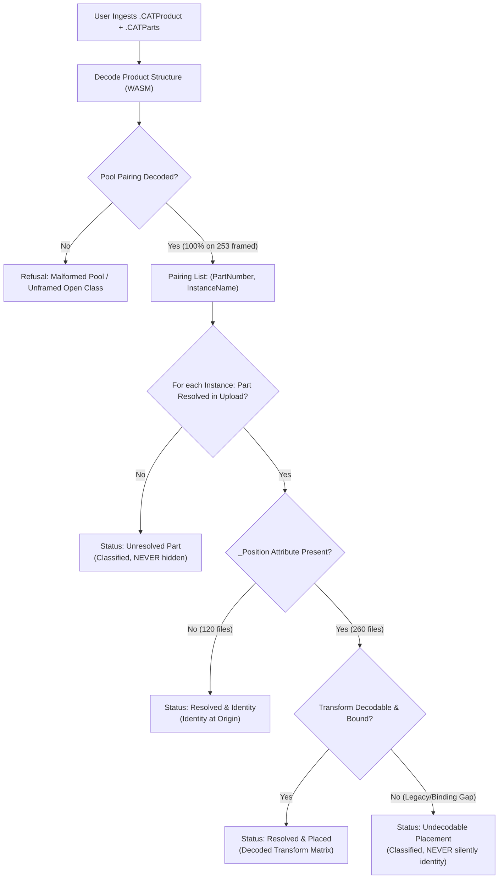
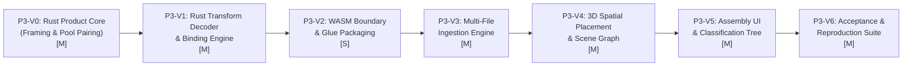

# Phase 6 spec — Web viewer, assemblies (Ticket P3 under Spec F #45)

**Status: SPEC — the Phase 6 Assembly Viewer design authority.**  
Context: Follows the closure and publication of Phase 5 (parts viewer, L2 delivery surface, 2026-11-14). Strictly enforces the declared P4 Assembly Bar ([docs/evidence/2026-11-14-p4-assembly-bar.md](file:///home/alan/Documents/Repos/catpart-parser/docs/evidence/2026-11-14-p4-assembly-bar.md), committed pre-implementation under Option 2) and builds upon the committed census and decode evidence: P1 product census ([docs/evidence/2026-11-14-p1-product-census.md](file:///home/alan/Documents/Repos/catpart-parser/docs/evidence/2026-11-14-p1-product-census.md)), P2 structure-pool pairing laws ([docs/evidence/2026-11-14-p2-pool-pairing.md](file:///home/alan/Documents/Repos/catpart-parser/docs/evidence/2026-11-14-p2-pool-pairing.md)), P2.5 position-value encoding probe ([docs/evidence/2026-11-14-p25-position-encoding.md](file:///home/alan/Documents/Repos/catpart-parser/docs/evidence/2026-11-14-p25-position-encoding.md)), and P2.6 instance-binding analysis ([scripts/triage/p26_instance_binding.py](file:///home/alan/Documents/Repos/catpart-parser/scripts/triage/p26_instance_binding.py)).

This specification governs the architecture, mathematical contracts, WASM FFI boundaries, ingestion pipelines, WebGL scene-graph lifecycle, and UI interfaces for Ticket P3 (Assembly Mode in the Web Viewer).

---

## 1. Scope and Principles

### 1.1 In Scope

- **Multi-File Ingestion Pipeline**:
  - Drag-and-drop and file-picker ingestion of a root `.CATProduct` file alongside an arbitrary collection of component `.CATPart` files.
  - Native client-side directory ingestion (folder drop via `DataTransferItem.webkitGetAsEntry()` / recursive directory walker and directory picker `<input type="file" webkitdirectory directory multiple>`).
  - Native client-side ZIP archive ingestion without third-party npm packages or bundlers, using browser-native `DecompressionStream('deflate-raw')`.
  - In-memory Virtual File Catalog establishing the **248/382 same-repo PartNumber resolution law** (derived from P1 §3.3).
- **WASM Decode Core Extension (`port/src/product/`)**:
  - Pure Rust port of the binary record framing (`fe 7c 02 <u32le ln>`), Law-B SHORT item chain, and 00-escape LONG item chain.
  - Structure pool item parsing, token identification, and pairing extraction: Identity Triples (216/253 FACT), Description Blocks (17 files), and Bare Pairs (9 files).
  - Explicit separation of true component part instances from assembly constraint markers (`Offset.*`, `Coincidence.*`, `Surface contact.*`, `Fix.*`).
  - Extraction and validation of the 56-byte transform records `[tx, ty, tz, qw, qx, qy, qz]` f64le with unit-quaternion normalization (`QUAT_NORM_TOL = 1e-9`) and mm-scale translation bounds (`1e-9 <= |t| <= 1e6`).
  - Execution of the instance binding laws: `sequential_1to1`, `root_plus_sequential`, `connector_proxy_mesh`, and `identity_default`.
- **WASM Boundary (`port/src/wasm_boundary.rs`)**:
  - Addition of `decode_product_structure(bytes: &[u8]) -> Result<JsValue, JsValue>` returning product metadata, declared instances, resolution keys, transform vectors, and classified refusal states.
  - Preservation of the single-part entry `decode_export(bytes: &[u8])` unchanged, enabling zero-copy instancing of individual `.CATPart` geometries.
- **3D Spatial Assembly Placement**:
  - Mathematical mapping of CATIA right-handed Z-up coordinates to Three.js right-handed Y-up coordinates via an Assembly Root basis-change transformation $B = R_X(-\pi/2)$.
  - Direct translation of decoded w-first unit quaternions `(qw, qx, qy, qz)` to Three.js `THREE.Quaternion(qx, qy, qz, qw)`.
  - Geometry-sharing instancing model: component `.CATPart` buffers decoded once and shared across multiple `THREE.Mesh` instances with unique local matrices.
  - Assembly bounding sphere/box computation, camera auto-framing, wireframe toggles, curve overlay integration, and interactive exploded view.
- **Instance Tree & Classification UI (`site/viewer/`)**:
  - Assembly tree display with root product name, detected CATIA release version, and comprehensive instance list.
  - Strict adherence to the **4 Canonical Classification States**:
    1. `Resolved & Placed`
    2. `Resolved & Identity`
    3. `Unresolved Part` (never hidden)
    4. `Undecodable Placement` (never silently defaulted to identity)
  - Selected instance inspector showing live 4x4 matrix, raw CATIA 7-tuple parameters, and resolution source.

### 1.2 Out of Scope

- B-rep / STEP export (Phase 7).
- Re-authoring, editing, constraint solving, or kinematics simulation.
- Server-side execution or external API calls (the viewer remains 100% static on GitHub Pages per ADR-0003).
- Bundlers (webpack, vite, rollup) or npm runtime dependencies (`node_modules` remains strictly prohibited in `site/`).

### 1.3 Target Surface and Memory Envelope

- **Target**: Modern desktop browsers (Chromium, Firefox, Safari) with WebAssembly and WebGL2 support.
- **Memory Budget**:
  - The largest single corpus file is ~120 MB. In multi-part assemblies, total uncompressed file payloads can reach 300–500 MB across dozens of components.
  - The viewer MUST minimize transient memory spikes. Single-part meshes are cached by canonical `PartNumber`. If an assembly contains 50 instances of `Bolt_M8.CATPart`, the mesh geometry is decoded and allocated on the GPU **exactly once** (`THREE.BufferGeometry`), and referenced by 50 lightweight `THREE.Mesh` scene-graph nodes.
  - Full disposal lifecycle (`geometry.dispose()`, `material.dispose()`) is enforced when clearing or switching assemblies.

---

## 2. Format Decoding & Port Architecture (`port/src/product/`)

### 2.1 Crate Organization

The Rust core in `port/src/` is extended with a dedicated `product` module hierarchy, maintaining 1:1 conceptual parity with the triage decoders (`p2_pool_pairing.py`, `p25_position_encoding.py`, `p26_instance_binding.py`):

```
port/src/
├── lib.rs
├── wasm_boundary.rs          # Grows decode_product_structure()
├── product/
│   ├── mod.rs                # Product orchestration & public types
│   ├── framing.rs            # fe 7c 02 record framing scanner & length law
│   ├── pool.rs               # Law-B SHORT/LONG chain tiling & token classifier
│   ├── pairing.rs            # Identity triple, desc-block, and bare-pair engine
│   ├── transforms.rs         # CATCtorProxyCont 129b/81b transform record parser
│   └── binding.rs            # Instance-to-record binding laws & classification
└── geometry/                 # Existing L2 mesh & composite decode (untouched)
```

### 2.2 The Pool Framing and Item Tiling Law

Per P2 evidence ([docs/evidence/2026-11-14-p2-pool-pairing.md](file:///home/alan/Documents/Repos/catpart-parser/docs/evidence/2026-11-14-p2-pool-pairing.md) §2, Claim `P2-framing-scan`):
The CATProduct structure pool is framed by a record anchored at bytes `fe 7c 02`:

```
Offset   Length   Field             Description
--------------------------------------------------------------------------------------
0x00     2        b"\xfe\x7c"       Frame signature
0x02     1        0x02              Frame tag (structure pool)
0x03     4        u32le ln          Length field (counts bytes from 0x01 through pool end)
0x07     tb       tail_bytes        1-2 bytes (high-bit set; tb in {0, 1, 2})
0x07+tb  pool_span items...         Tiled item chain spanning [0x07+tb, 0x01+ln)
```

**The Length Law** (`P2-length-law`, 100% verified):
$$\text{ln} = 6 + tb + \text{pool\_span}$$
The framing record spans $[h, h + 1 + \text{ln})$. If multiple `fe 7c 02` records exist in the file (common on 239/380 files carrying electrical, measure, or specification pools), the structure pool is uniquely disambiguated by requiring $\ge 2$ assembly vocabulary tokens (`ASMPRODUCT`, `PRDREP`, `_InstanceName`, `_PartNumber`, `_Component`).

**Item Chain Tiling Law** (`P2-chain-tiling`):
The pool payload tiles completely into two item types with zero padding and zero delimiters:
1. **SHORT item (Law B)**: `<u8 L> <L-1 payload bytes>`, $L \ge 1$. $L=1$ represents an empty string. Payload is UTF-8 text with optional newlines (`\n`).
2. **LONG item (00-escape)**: `<0x00> <u32le n> <n payload bytes>`, $n \ge 1$. Length $n$ is the exact byte/char count. Carries relation strings (e.g. `CtorToProd:...`).

### 2.3 The Pairing Laws & Constraint Separation

The decoded pool item sequence is parsed into instances according to three verified laws:

1. **Identity Triple** (`P2-identity-triple`, 216/253 framed files, FACT):
   $$\langle\text{PartNumber}\rangle \quad \texttt{\_InstanceName} \quad \langle\text{InstanceName}\rangle$$
   The instance's component part number strictly precedes the `_InstanceName` token; the instance name strictly follows it.
2. **Description Block** (`P2-desc-instance-block`, 17 files, FACT):
   $$\langle\text{PN}\rangle \quad \texttt{\_DescriptionInst} \quad \langle\text{PN:1}\rangle \quad \texttt{\_InstanceName} \quad \langle\text{PN\_1}\rangle \quad \texttt{\_Position}$$
   Serializes colon-form (`PN:1`) and underscore-form (`PN_1`) instance aliases alongside the `_Position` attribute token.
3. **Bare Pair Adjacency** (`P2-bare-pair`, 9 files, INFERENCE):
   $$\langle\text{PartNumber}\rangle \quad \langle\text{InstanceName}\rangle$$
   Adjacent strings matching `<stem>` and `<stem>.<N>` without an intervening `_InstanceName` token.

#### Constraint Separation Rule (P2.6 Resolution)
In CATIA V5, assembly constraints (e.g. `Coincidence.1`, `Surface contact.2`, `Offset.1`, `Fix.1`) are serialized using the same dot-shape `<name>.<N>` naming convention. The parser MUST filter constraints to avoid phantom instances. A dot-shaped name is classified as an assembly constraint if its case-insensitive prefix matches any of the canonical CATIA constraint tokens:
`coincidence`, `coïncidence`, `cx_coincidence`, `surface contact`, `contact surfacique`, `cx_surface contact`, `offset`, `décalage`, `fix`, `fixe`, `angle`, `contact linéique`, `line contact`, `contact ponctuel`, `point contact`, `parallelism`, `parallélisme`, `perpendicularity`, `perpendicularité`.

Instances whose prefix matches this vocabulary are classified as assembly constraints and excluded from the physical part instance tree.

### 2.4 Transform Record Decoding & Numeric Contract

Per P2.5 evidence ([docs/evidence/2026-11-14-p25-position-encoding.md](file:///home/alan/Documents/Repos/catpart-parser/docs/evidence/2026-11-14-p25-position-encoding.md) §3, P25-1, P25-7, P25-14) and P2.6 anatomy ([scripts/triage/p26_instance_binding.py](file:///home/alan/Documents/Repos/catpart-parser/scripts/triage/p26_instance_binding.py)):

Transforms reside in the `CATCtorProxyCont` block or `Cont_*` tail-catalog regions. Placement records occur in two primary physical structures:

1. **129-byte Full Transform Record**:
   - `0x00..0x04`: Tag/Magic (`b"\xb5\x13\x27\x79"` or `b"\xb5\x03\x27\x79"`).
   - `0x04..0x08`: `u32le` OmbObjectTag ID.
   - `0x08`: Invariant separator byte `0x80`.
   - `0x09..0x21`: Translation vector `[tx, ty, tz]` (3 $\times$ `f64le`).
   - `0x21..0x41`: Rotation unit quaternion `[qw, qx, qy, qz]` (4 $\times$ `f64le`), **w-first**.
   - `0x41..0x61`: Flags / coordinate qualifiers (4 $\times$ `f64le`).
   - `0x61..0x81`: Bounding box sentinels / extents (4 $\times$ `f64le`).
2. **81-byte Connector Point Record**:
   - `0x00..0x08`: Header + Object ID.
   - `0x08`: Invariant separator `0x80`.
   - `0x09..0x51`: Point coordinates (3 $\times$ `f64le`), axis direction (4 $\times$ `f64le`), limits (2 $\times$ `f64le`).

#### The Numeric Contract
1. **Precision**: All transform coordinates are decoded as native `f64le` little-endian floating point values. No lossy `f32` conversion is performed during matrix composition.
2. **Quaternion Unit Norm**:
   $$\left| q_w^2 + q_x^2 + q_y^2 + q_z^2 - 1.0 \right| \le 10^{-9}$$
3. **Translation Bounds**:
   $$t_i = 0.0 \quad \lor \quad 10^{-9} \le |t_i| \le 10^6 \quad (\text{mm})$$
4. **Header Constant False-Positive Rejection**:
   Patterns at offset $< \text{0x400}$ matching `(0, 0, 1, 0, 0, 0, 1)` or `(0, 0, 0, 0, 0, 0, 1)` are fixed false positives from the header constant table (P25-11) and are rejected.
5. **Lint and Fast-Math Restrictions**:
   In accordance with Phase 5 §2.2, all transform decoding code in `port/src/product/` carries `#![allow(clippy::suboptimal_flops)]`. Fused multiply-add (`mul_add`) is forbidden to preserve bit-exact arithmetic across compilers.

### 2.5 Instance Binding Modes

The bridge between pool instances and transform records operates under 5 deterministic binding modes (P2.6):

| Binding Mode | Condition | Placement Action |
|---|---|---|
| `sequential_1to1` | Number of transform records equals number of placed pool instances ($N_{\text{rec}} = N_{\text{inst}}$). | Record $i$ maps directly to placed instance $i$. |
| `root_plus_sequential` | Number of transform records equals $N_{\text{inst}} + 1$. Record 0 is product root transform. | Record 0 applied to root group; record $i+1$ maps to instance $i$. |
| `connector_proxy_mesh` | Placed file carries complex constraint mesh ($N_{\text{rec}} \ne N_{\text{inst}}$). | Transforms mapped via ObjectTag ID sequence or primary component proxies; unmapped instances marked `Undecodable Placement`. |
| `identity_default` | File declares `_Position` token, but `recs_ctorproxy == 0` (220/260 placed files carry no override record). | Instances placed at identity $[0,0,0, 1,0,0,0]$ as explicit CATIA default. |
| `legacy_unframed_carrier` | R15 reference form with `80 ... e8/e7` tags (45 files). | Classified as `Undecodable Placement (R15 legacy reference tags undecoded)`. Never forced to identity. |

---

## 3. The Declared P4 Assembly Bar & Classification Model

The P4 Assembly Bar ([docs/evidence/2026-11-14-p4-assembly-bar.md](file:///home/alan/Documents/Repos/catpart-parser/docs/evidence/2026-11-14-p4-assembly-bar.md)) establishes three non-negotiable clauses that govern Phase 6:



### 3.1 The Three Bar Clauses

1. **Clause 1 (Instance Structure)**: The viewer lists each product's instances as `(PartNumber, InstanceName)` with 100% agreement against the committed pairing law on the framed population (253 files; R18–R26 clean scope 230/230 at 100%).
2. **Clause 2 (Resolution)**: Each instance's `PartNumber` resolves to a part file by part number (the 248/382 same-repo stem join law). Unresolved instances display classified — **never hidden**.
3. **Clause 3 (Placement)**: Instances render with DECODED transforms. Identity placement is the fallback **ONLY** for the no-`_Position` class (120 files). There is **NO identity-fallback masking** for undecoded transforms: undecodable placement displays classified as such.

### 3.2 The Four Canonical Instance States

Every instance declared by a `.CATProduct` file must resolve to exactly one of the four mutually exclusive states:

| Canonical State | Ingestion Match | Format `_Position` | Transform Decode | Visual Representation | UI Badge |
|---|---|---|---|---|---|
| **`Resolved & Placed`** | `.CATPart` uploaded & decoded successfully | Present in pool | Successfully decoded & bound `[t, q]` | 3D mesh positioned at $T(t, q)$ | `pill good` Placed |
| **`Resolved & Identity`** | `.CATPart` uploaded & decoded successfully | Absent from pool | None (No placement record declared) | 3D mesh positioned at origin $[0,0,0]$ | `pill neutral` Identity (No _Position) |
| **`Unresolved Part`** | `.CATPart` NOT found in user upload | Any | Any | Bounding box placeholder or hidden; tree entry preserved | `pill warn` Unresolved Part |
| **`Undecodable Placement`** | `.CATPart` uploaded & decoded successfully | Present in pool | Cannot decode (R15 `e8/e7` tags, legacy form, open binding) | Standoff diagnostic offset or highlighted error silhouette; NEVER origin identity | `pill bad` Undecodable Placement |

> [!CAUTION]
> **The Anti-Masking Invariant**:
> If an instance has a `_Position` token in CATIA, but its placement record is undecodable (e.g. R15 generation or complex constraint mesh), code MUST NEVER set $t = [0,0,0], q = [1,0,0,0]$ and declare it valid. Defaulting an undecodable placement to identity violates Clause 3 of the declared P4 bar. Such instances must be rendered with an explicit diagnostic visual treatment and classified in the tree as `Undecodable Placement`.

---

## 4. Multi-File Ingestion Pipeline

### 4.1 Ingestion Modalities

The viewer shell (`site/viewer/`) must support three seamless, client-side input modalities:

```
[ Ingestion Modalities ]
 ├── 1. Folder Drop (Drag directory onto drop zone -> webkitGetAsEntry recursive walk)
 ├── 2. Multi-File Picker (<input type="file" multiple accept=".CATProduct,.CATPart,...">)
 └── 3. ZIP Archive Drop (Native client-side DecompressionStream('deflate-raw'))
```

#### Modality 1: Recursive Directory Drop
When a folder is dropped onto the drop zone:
```javascript
async function scanDataTransfer(dataTransfer) {
  const entries = [];
  const items = dataTransfer.items;
  for (let i = 0; i < items.length; i++) {
    const entry = items[i].webkitGetAsEntry ? items[i].webkitGetAsEntry() : null;
    if (entry) {
      await traverseFileSystemEntry(entry, entries);
    } else {
      const file = items[i].getAsFile();
      if (file) entries.push(file);
    }
  }
  return entries;
}

async function traverseFileSystemEntry(entry, list) {
  if (entry.isFile) {
    const file = await new Promise((resolve) => entry.file(resolve));
    list.push(file);
  } else if (entry.isDirectory) {
    const reader = entry.createReader();
    const subEntries = await new Promise((resolve) => reader.readEntries(resolve));
    for (const sub of subEntries) {
      await traverseFileSystemEntry(sub, list);
    }
  }
}
```

#### Modality 2: Multi-File Selection
`<input type="file" id="assembly-file-input" multiple accept=".CATProduct,.catproduct,.CATPart,.catpart,.zip">` allows direct multi-file selection from standard OS file dialogues.

#### Modality 3: Client-Side Zero-Dependency ZIP Extraction
To preserve the zero-npm, static-site architectural principle, ZIP archives are unpacked in-memory using browser-native `DecompressionStream('deflate-raw')`. The central directory of the ZIP file is parsed to extract file records, and compressed streams are decompressed into `Uint8Array` buffers without external libraries.

### 4.2 In-Memory Virtual File Catalog

All ingested files are registered into an in-memory catalog:

```typescript
interface CatalogEntry {
  file: File | { name: string; bytes: Uint8Array };
  stem: string;             // Basename without extension
  extension: string;        // Lowercase extension (.catpart / .catproduct)
  bytes: Uint8Array | null; // Loaded lazily or eagerly
}

class VirtualFileCatalog {
  private exactStems: Map<string, CatalogEntry> = new Map();
  private lowerStems: Map<string, CatalogEntry> = new Map();
  public products: CatalogEntry[] = [];

  public register(entry: CatalogEntry) {
    if (entry.extension === ".catproduct") {
      this.products.push(entry);
    }
    this.exactStems.set(entry.stem, entry);
    this.lowerStems.set(entry.stem.toLowerCase(), entry);
  }

  public resolvePart(partNumber: string): CatalogEntry | null {
    // 1. Exact stem match (e.g. "ac1" -> "ac1.CATPart")
    if (this.exactStems.has(partNumber)) {
      return this.exactStems.get(partNumber)!;
    }
    // 2. Case-insensitive fallback (e.g. "AC1" -> "ac1.catpart")
    const lower = partNumber.toLowerCase();
    if (this.lowerStems.has(lower)) {
      return this.lowerStems.get(lower)!;
    }
    return null;
  }
}
```

### 4.3 Root Product Resolution & Multi-Product Disambiguation

If an uploaded dataset contains multiple `.CATProduct` files (e.g. sub-assemblies):
1. **Heuristic Selection**: If one product contains `IsRoot` as its terminal token and matches the folder root name, it is selected as the default root.
2. **User Switcher**: The UI metadata panel displays a root selector dropdown (`<select id="root-product-select">`), allowing the user to switch the active root product instantaneously.

---

## 5. 3D Spatial Assembly Placement & WebGL Scene Graph

### 5.1 Coordinate System Reconciliation

CATIA V5 and Three.js use different 3D coordinate conventions:

- **CATIA V5**: Right-handed, **Z-up** ($+X$ = Right, $+Y$ = In-depth/North, $+Z$ = Up).
- **Three.js**: Right-handed, **Y-up** ($+X$ = Right, $+Y$ = Up, $+Z$ = Out of screen/South).

#### Mathematical Basis Transform
To map a point $p_C = (x_C, y_C, z_C)^T$ in CATIA space to $p_T = (x_T, y_T, z_T)^T$ in Three.js space while preserving right-handedness:
$$\begin{pmatrix} x_T \\ y_T \\ z_T \end{pmatrix} = \begin{pmatrix} 1 & 0 & 0 \\ 0 & 0 & 1 \\ 0 & -1 & 0 \end{pmatrix} \begin{pmatrix} x_C \\ y_C \\ z_C \end{pmatrix}$$

This basis transformation matrix $B$ is identical to a $-90^\circ$ ($-\pi/2$ radians) rotation about the X-axis:
$$B = R_X(-\pi/2) = \begin{pmatrix} 1 & 0 & 0 \\ 0 & \cos(-\pi/2) & -\sin(-\pi/2) \\ 0 & \sin(-\pi/2) & \cos(-\pi/2) \end{pmatrix} = \begin{pmatrix} 1 & 0 & 0 \\ 0 & 0 & 1 \\ 0 & -1 & 0 \end{pmatrix}$$

#### Scene Graph Architecture
Instead of mutating the decoded vertex arrays of every `.CATPart` file (which would destroy bit-exact coordinate parity with the Python L2 reference and PLY files), the basis change is applied **once** to an `AssemblyRoot` node:

```
Three.Scene (Default Y-up world)
  └── AssemblyRoot (THREE.Group: rotation.x = -Math.PI / 2)
        │    # Local coordinate space inside AssemblyRoot is bit-exact CATIA Z-up
        ├── Instance_1 (THREE.Group: matrix = M_1)
        │     └── Part_A_Mesh (THREE.Mesh: shared Geometry_A)
        ├── Instance_2 (THREE.Group: matrix = M_2)
        │     └── Part_B_Mesh (THREE.Mesh: shared Geometry_B)
        └── Instance_3 (THREE.Group: matrix = M_3)
              └── Part_A_Mesh (THREE.Mesh: shared Geometry_A)  <-- Reuses Geometry_A!
```

Any point transformed by $M_{\text{instance}}$ remains in pure CATIA coordinates; the parent `AssemblyRoot` performs the single screen-orientation projection automatically in the WebGL pipeline.

### 5.2 Quaternion Transformation Pipeline

CATIA transform records store coordinates as a 7-tuple:
$$\mathbf{T}_{\text{CATIA}} = [t_x, t_y, t_z, q_w, q_x, q_y, q_z]$$
where $q = (q_w, q_x, q_y, q_z)$ is a unit quaternion with $q_w$ (the scalar part) stored **first** (P2.5 §4).

#### Quaternion Rotation Matrix Formulation
Given unit quaternion $q = (w, x, y, z)$ with $w^2 + x^2 + y^2 + z^2 \approx 1$:
$$R(q) = \begin{pmatrix}
1 - 2(y^2 + z^2) & 2(xy - wz) & 2(xz + wy) \\
2(xy + wz) & 1 - 2(x^2 + z^2) & 2(yz - wx) \\
2(xz - wy) & 2(yz + wx) & 1 - 2(x^2 + y^2)
\end{pmatrix}$$

#### Construction in Three.js
In Three.js, the constructor for `THREE.Quaternion` accepts arguments in the order `(x, y, z, w)`:

```javascript
// Mapping CATIA w-first record [tx, ty, tz, qw, qx, qy, qz]
const tx = record[0];
const ty = record[1];
const tz = record[2];
const qw = record[3];
const qx = record[4];
const qy = record[5];
const qz = record[6];

// Three.js takes (x, y, z, w)
const quat = new THREE.Quaternion(qx, qy, qz, qw);
quat.normalize(); // Guard against minute float rounding

const pos = new THREE.Vector3(tx, ty, tz);
const scale = new THREE.Vector3(1.0, 1.0, 1.0);

const localMatrix = new THREE.Matrix4().compose(pos, quat, scale);
instanceGroup.matrix.copy(localMatrix);
instanceGroup.matrixAutoUpdate = false; // Pin matrix explicitly
```

### 5.3 Geometry Instancing & GPU Memory Optimization

To guarantee performance on large industrial assemblies without exceeding browser memory limits:
1. **Geometry Pool**: A dictionary `Map<PartNumber, { geometry: THREE.BufferGeometry, curves: THREE.Group }>` stores decoded part geometries.
2. **Decode Once**: When multiple instances cite the same `PartNumber`, `decode_export` executes only on the first encounter. Subsequent instances clone the `THREE.Mesh` handle, referencing the identical `THREE.BufferGeometry` in GPU VRAM.
3. **Disposal Guarantee**: When loading a new assembly, the viewer iterates through the geometry pool and executes:
   ```javascript
   for (const entry of geometryPool.values()) {
     entry.geometry.dispose();
     if (entry.material) entry.material.dispose();
   }
   geometryPool.clear();
   ```

### 5.4 Exploded View Pipeline

The viewer provides an optional interactive exploded view slider ($s \in [0.0, 3.0]$) to assist visual inspection of tightly packed assemblies.

Let $C_{\text{asm}}$ be the center of the assembly bounding box in CATIA coordinates. For an instance with base position $t_i$ and bounding box center $c_i$:
1. Direction vector: $d_i = \frac{c_i - C_{\text{asm}}}{\|c_i - C_{\text{asm}}\|}$ (if $\|c_i - C_{\text{asm}}\| < 10^{-6}$, fallback to $d_i = (0, 0, 1)$).
2. Exploded translation: $t_i(s) = t_i + s \cdot \Delta_{\text{explode}} \cdot d_i$, where $\Delta_{\text{explode}} = 0.5 \cdot \text{radius}(B_{\text{asm}})$.
3. Matrix update: re-compose local matrix with $t_i(s)$ while preserving quaternion $q_i$.

---

## 6. Instance Tree & Classification UI

### 6.1 Layout & DOM Architecture

The assembly viewer extends `site/viewer/viewer.html` into a dual-mode layout (Part Mode vs. Assembly Mode):

```
+-----------------------------------------------------------------------------------+
|  Header: Phase 6 · Assembly Viewer (gh-pages static)                             |
+-------------------------------------------------------+---------------------------+
|                                                       |  Side Panel:              |
|  Viewport Canvas (Three.js WebGL2)                    |  +---------------------+  |
|                                                       |  | Product Metadata    |  |
|  - Assembly 3D Render (Instances in space)            |  | Root: Dictor_Prod1  |  |
|  - Camera Orbit / Pan / Zoom                          |  | Parts: 12 / 14      |  |
|                                                       |  +---------------------+  |
|                                                       |  | Assembly Tree       |  |
|  Controls Bar:                                        |  | [o] Part001.1 Placed|  |
|  [Wireframe] [Curves] [Explode: =====o=] [Reset View] |  | [o] Part002.1 Ident |  |
|                                                       |  | [x] Bolt_M6.1 Miss  |  |
|                                                       |  +---------------------+  |
|                                                       |  | Instance Inspector  |  |
|                                                       |  | t=[-5.0, -15.5, 180]|  |
|                                                       |  +---------------------+  |
+-------------------------------------------------------+---------------------------+
```

### 6.2 Assembly Instance Tree Hierarchy

The tree view (`#assembly-tree`) renders every declared instance with its verified status badge:

```html
<ul class="assembly-tree">
  <li class="tree-node status-placed" data-instance-id="Part001.1">
    <div class="node-row">
      <input type="checkbox" class="inst-vis-toggle" checked title="Toggle visibility">
      <button class="node-select-btn" type="button">
        <span class="inst-name">Part001.1</span>
        <span class="part-number dim">(Part001)</span>
      </button>
      <span class="pill good">Placed</span>
    </div>
  </li>
  <li class="tree-node status-identity" data-instance-id="Part0024.1">
    <div class="node-row">
      <input type="checkbox" class="inst-vis-toggle" checked>
      <button class="node-select-btn" type="button">
        <span class="inst-name">Part0024.1</span>
        <span class="part-number dim">(Part0024)</span>
      </button>
      <span class="pill neutral">Identity</span>
    </div>
  </li>
  <li class="tree-node status-unresolved" data-instance-id="MissingBracket.1">
    <div class="node-row">
      <input type="checkbox" class="inst-vis-toggle" disabled>
      <button class="node-select-btn" type="button">
        <span class="inst-name">MissingBracket.1</span>
        <span class="part-number dim">(Bracket_RevB)</span>
      </button>
      <span class="pill warn">Unresolved Part</span>
    </div>
  </li>
  <li class="tree-node status-undecodable" data-instance-id="LegacyPin.1">
    <div class="node-row">
      <input type="checkbox" class="inst-vis-toggle" checked>
      <button class="node-select-btn" type="button">
        <span class="inst-name">LegacyPin.1</span>
        <span class="part-number dim">(Pin_10mm)</span>
      </button>
      <span class="pill bad">Undecodable Placement</span>
    </div>
  </li>
</ul>
```

### 6.3 Instance Inspector Panel

When an instance node is selected in the tree or clicked in the 3D scene:
- Focuses camera onto the instance's bounding sphere (`orbit.frame(center, radius)`).
- Displays raw CATIA translation coordinates $(t_x, t_y, t_z)$ in millimeters.
- Displays unit quaternion components $(q_w, q_x, q_y, q_z)$ with computed Euler angles (degrees) and rotation axis.
- Displays resolution source: matched `.CATPart` file name, byte size, vertex count, and triangle count.
- For `Undecodable Placement`, displays the exact classified refusal (e.g. `r15-reference-tags-undecoded` or `constraint-proxy-unmapped`).

---

## 7. WASM Boundary Extension

### 7.1 Rust Data Structures

In `port/src/product/mod.rs`:

```rust
use serde::{Deserialize, Serialize};

#[derive(Serialize, Deserialize, Debug, Clone)]
pub struct ProductStructureDocument {
    pub schema_version: u32,
    pub product_name: String,
    pub detected_version: String,
    pub pool_form: String, // "framed" | "r15-ref" | "unframed"
    pub total_instances: usize,
    pub placed_instances: usize,
    pub identity_instances: usize,
    pub instances: Vec<ProductInstanceRecord>,
    pub warnings: Vec<ProductWarning>,
}

#[derive(Serialize, Deserialize, Debug, Clone)]
pub struct ProductInstanceRecord {
    pub instance_name: String,
    pub part_number: String,
    pub pairing_rule: String,    // "triple" | "desc_block" | "bare_pair" | "name_table"
    pub has_position_attr: bool, // True if _Position token declared
    pub placement_status: String,// "placed" | "identity" | "undecodable"
    pub transform: Option<[f64; 7]>, // [tx, ty, tz, qw, qx, qy, qz]
    pub object_tag: Option<u32>, // OmbObjectTag if present
    pub classification_detail: Option<String>,
}

#[derive(Serialize, Deserialize, Debug, Clone)]
pub struct ProductWarning {
    pub class: String,
    pub detail: String,
}
```

### 7.2 Entry Point in `wasm_boundary.rs`

```rust
use crate::product::decode_product_buffer;

/// The Phase 6 product structure entry point.
/// Accepts raw bytes of a .CATProduct file and returns the parsed
/// hierarchy, instance list, and transform vectors.
#[wasm_bindgen]
pub fn decode_product_structure(bytes: &[u8]) -> Result<JsValue, JsValue> {
    if bytes.is_empty() {
        return Err(classified_error(
            INSPECT_CRASH,
            "empty buffer: cannot decode product structure from 0 bytes",
        ));
    }

    match decode_product_buffer(bytes) {
        Ok(doc) => to_value(&doc).map_err(|err| {
            classified_error(
                IO_ERROR,
                &format!("cannot serialize product structure: {err}"),
            )
        }),
        Err(refusal) => Err(classified_error(refusal.error_class, &refusal.detail)),
    }
}
```

### 7.3 TypeScript Interface Definition (`site/viewer/types.d.ts`)

```typescript
export interface ProductStructureDocument {
  schema_version: number;
  product_name: string;
  detected_version: string;
  pool_form: "framed" | "r15-ref" | "unframed";
  total_instances: number;
  placed_instances: number;
  identity_instances: number;
  instances: ProductInstanceRecord[];
  warnings: ProductWarning[];
}

export interface ProductInstanceRecord {
  instance_name: string;
  part_number: string;
  pairing_rule: "triple" | "desc_block" | "bare_pair" | "name_table";
  has_position_attr: bool;
  placement_status: "placed" | "identity" | "undecodable";
  transform: [number, number, number, number, number, number, number] | null;
  object_tag?: number;
  classification_detail?: string;
}

export interface ProductWarning {
  class: string;
  detail: string;
}
```

---

## 8. Ticket Breakdown (Phase 6, Ticket P3)

The implementation of Phase 6 Viewer Assembly Mode is partitioned into 7 bounded, verifiable child tickets following the house dispatch discipline ([docs/agents/dispatch-recipes.md](file:///home/alan/Documents/Repos/catpart-parser/docs/agents/dispatch-recipes.md)):



### P3-V0: Rust Product Core (Framing & Pool Pairing) — **M**

- **Scope**: Implement `port/src/product/framing.rs` and `pool.rs`. Port the `fe 7c 02` scanner, Law B SHORT/LONG chain walker, token classifier, and the three pairing rules (triple, desc-block, bare-pair). Implement constraint separation logic. Add native unit tests.
- **Acceptance**: `cargo test` passes; 100% agreement on synthetic A2 product fixtures and sample corpus test vectors against `p2_pool_pairing.py`.
- **Estimate**: M.

### P3-V1: Rust Transform Record Decoder & Binding Engine — **M**

- **Scope**: Implement `port/src/product/transforms.rs` and `binding.rs`. Decode 129-byte and 81-byte records in `CATCtorProxyCont` and `Cont_*` regions. Apply unit quaternion gate (`1e-9`), translation bounds, header FP filter. Implement `sequential_1to1`, `root_plus_sequential`, and `identity_default` binding modes.
- **Acceptance**: Native tests pass on Dictor (`Product1.CATProduct`), Apoloo13 (`lengua.CATProduct`), and synthetic transform records.
- **Depends**: P3-V0. **Estimate**: M.

### P3-V2: WASM Boundary & Glue Packaging — **S**

- **Scope**: Wire `decode_product_structure` into `port/src/wasm_boundary.rs`. Serialize structs via `serde_wasm_bindgen`. Rebuild WASM artifacts with `wasm-pack build --target web` into `port/pkg/`. Update `scripts/check.sh` to track pkg sync.
- **Acceptance**: `wasm-bindgen-test` under Node passes; TypeScript definitions validated.
- **Depends**: P3-V1. **Estimate**: S.

### P3-V3: Multi-File Ingestion Engine — **M**

- **Scope**: Implement `site/viewer/catalog.js` and `site/viewer/ingest.js`. Support folder drop (`webkitGetAsEntry`), multi-file picker, and native client-side ZIP extraction (`DecompressionStream`). Implement case-normalized stem resolution matching the 248/382 same-repo join law.
- **Acceptance**: Dropping a multi-file folder or zip successfully builds the catalog and resolves part stems.
- **Depends**: P3-V2. **Estimate**: M.

### P3-V4: 3D Spatial Assembly Placement & Scene Graph — **M**

- **Scope**: Implement `site/viewer/assembly_scene.js`. Build `AssemblyRoot` node with $R_X(-\pi/2)$ orientation. Compose Three.js matrices from w-first quaternions. Implement geometry caching and GPU buffer sharing across instances. Add exploded-view logic and auto-framing.
- **Acceptance**: Decoded assembly renders in correct spatial orientation; memory footprint verified to allocate each unique part geometry only once.
- **Depends**: P3-V3. **Estimate**: M.

### P3-V5: Assembly UI & Classification Tree — **M**

- **Scope**: Implement `site/viewer/assembly_ui.js` and update `viewer.html` / `viewer.css`. Render the hierarchical instance tree with the 4 status badges (`Placed`, `Identity`, `Unresolved Part`, `Undecodable Placement`). Add visibility toggles, camera isolation, and the instance inspector.
- **Acceptance**: All 4 states display distinctly; unresolved parts are never hidden; undecodable placements never fall back to origin identity.
- **Depends**: P3-V4. **Estimate**: M.

### P3-V6: Acceptance & Reproduction Suite — **M**

- **Scope**: Create synthetic multi-file assembly fixtures in `tests/fixtures_gen.py`. Write headless Playwright test suite `scripts/assembly_viewer_acceptance.py`. Verify that the assembly mode satisfies all 3 clauses of the P4 Assembly Bar digit-for-digit.
- **Acceptance**: Automated headless Playwright run passes on all fixture scenarios; gate clean (`bash scripts/check.sh`).
- **Depends**: P3-V5. **Estimate**: M.

---

## 9. CI, Testing, & In-Browser Reproduction Strategy

### 9.1 Synthetic Assembly Fixtures

Following the A2 fixture discipline established in Phase 5:
- **`fixture_assembly_canonical`**: 1 root `.CATProduct` + 3 `.CATPart` files (`Base`, `Arm`, `Bolt`). Exercises `Resolved & Placed` with known non-zero translation and 90° rotation.
- **`fixture_assembly_identity`**: 1 root `.CATProduct` with no `_Position` tokens + 2 `.CATPart` files. Exercises `Resolved & Identity`.
- **`fixture_assembly_partial`**: 1 root `.CATProduct` declaring 4 parts, but user supplies only 2 `.CATPart` files. Exercises `Unresolved Part` (verifies nodes are rendered in tree with warning badge, never omitted).
- **`fixture_assembly_undecodable`**: 1 root `.CATProduct` carrying R15 legacy `80 ... e8` reference tags. Exercises `Undecodable Placement` (verifies anti-masking invariant: rejected from identity fallback).

### 9.2 Headless Playwright In-Browser Suite

A dedicated Playwright runner (`scripts/assembly_viewer_acceptance.py`) runs against a read-only local static server:
1. Ingests synthetic fixtures via folder and ZIP emulation.
2. Reads `window.viewer.assembly` state object.
3. Asserts:
   - Total instance count equals decoded pairing count.
   - 4-state classification tallies match expected fixture ground truth.
   - Bounding sphere of placed assembly is finite and non-zero.
   - GPU mesh allocations equal the unique `PartNumber` count (instancing proof).

### 9.3 Gate and CI Integration

- All Rust tests compile natively and for `wasm32-unknown-unknown` in CI.
- Node-based WASM tests run in GitHub Actions on synthetic fixtures.
- Corpus files NEVER enter CI (ADR-0003 preserved).

---

## 10. Risks & Honest Mitigations

| Risk | Impact | Mitigation |
|---|---|---|
| **1. Complex Constraint Mesh Binding Gap** | Assemblies with hundreds of constraints and connector proxies may fail 1:1 sequential mapping. | P2.6 binding engine classifies unmapped instances as `Undecodable Placement`. They are highlighted in the UI and never silently masked to identity (P4 Bar compliance). |
| **2. Browser Out-Of-Memory (OOM)** | Large assemblies (e.g. 50+ unique parts totaling >500 MB) could exhaust browser tab memory. | Strict geometry pooling: components decoded once; shared `BufferGeometry`; explicit disposal of previous assemblies before ingest; desktop-target documented scope. |
| **3. Quaternion Order Reversal** | Accidental `(x, y, z, w)` vs `(w, x, y, z)` misinterpretation would produce distorted 180° flips. | Mathematical contract pinned in §5.2 and verified by P25-14 contradiction tests. Synthetic fixtures test asymmetric rotations. |
| **4. Case-Sensitivity Collision Across OSes** | Windows paths are case-insensitive; Linux paths are case-sensitive. | The Virtual File Catalog uses exact-match primary lookup with case-insensitive fallback. |
| **5. Accidental Identity Fallback Leakage** | A developer might catch an undecodable placement and set matrix to identity to "make it render". | P4 Bar strictly audits classification. Undecodable placement throws a distinct status code caught by the Playwright gate. |

---

## 11. Amendment Register & References

- **2026-11-14**: P4 Assembly Bar declared ([docs/evidence/2026-11-14-p4-assembly-bar.md](file:///home/alan/Documents/Repos/catpart-parser/docs/evidence/2026-11-14-p4-assembly-bar.md)).
- **2026-11-14**: P1 Product Census completed ([docs/evidence/2026-11-14-p1-product-census.md](file:///home/alan/Documents/Repos/catpart-parser/docs/evidence/2026-11-14-p1-product-census.md)).
- **2026-11-14**: P2 Pool Pairing Laws decoded ([docs/evidence/2026-11-14-p2-pool-pairing.md](file:///home/alan/Documents/Repos/catpart-parser/docs/evidence/2026-11-14-p2-pool-pairing.md)).
- **2026-11-14**: P2.5 Position Encoding Probe landed ([docs/evidence/2026-11-14-p25-position-encoding.md](file:///home/alan/Documents/Repos/catpart-parser/docs/evidence/2026-11-14-p25-position-encoding.md)).
- **2026-11-16**: P2.6 Instance Binding Probe resolved constraint vs instance count and 129b/81b record anatomy ([scripts/triage/p26_instance_binding.py](file:///home/alan/Documents/Repos/catpart-parser/scripts/triage/p26_instance_binding.py)).
- **2026-11-16**: Initial Phase 6 Assembly Viewer Specification authored and published as design authority on main.
